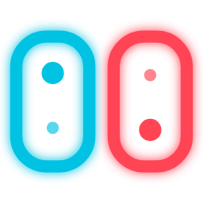

<p align="center">
  
</p>

<h1 align="center">Switch Hub</h1>

<p align="center">
  Browse your Nintendo Switch screenshots and clips, then share them with friends.<br>
  Gallery, chat, games and calls, straight between browsers. No uploads, no accounts.
</p>

<p align="center">
  <a href="https://codymkw.github.io/switch-hub/"><b>Open Switch Hub</b></a> ·
  <a href="CHANGELOG.md">Changelog</a> ·
  <a href="https://github.com/CodyMKW/switch-hub/issues">Report a bug</a>
</p>

---

## What is this?

Switch Hub is a single web page for people who take a lot of screenshots on their Switch and want to show them off. Point it at your SD card, and you get a fast, searchable gallery of everything you've captured. Connect to a friend and the two of you can browse each other's galleries, chat, watch slideshows together, jump on a voice call, or play a few quick games, all with your browsers talking directly to each other.

It started life as two separate little tools (a gallery and a chat app) and got merged into one because that just made more sense. Nothing is uploaded to a server, there's nothing to sign up for, and your captures stay on your computer unless you choose to send them.

## Try it

Open **[codymkw.github.io/switch-hub](https://codymkw.github.io/switch-hub/)**. There's nothing to install.

To load your own captures you need **Chrome, Edge or Opera on a desktop computer**, because reading a folder from your SD card relies on the File System Access API. Other browsers can still open the page, but the Load button stays disabled there.

## Quick start

1. Click **Load SD Card Folder** and pick your `Nintendo/Album` folder (or a USB export). Hub reads the files right in your browser.
2. Click **Invite Link** in the sidebar, copy it, and send it to a friend.
3. When they open it, the two of you connect automatically and show up in each other's friends list. Click them to browse their gallery or start chatting.

Your invite link stays the same every time, so you only need to send it once. If you ever need a new one (new device, cleared browser data), grab a fresh one from the sidebar or use **Reset my ID** in Settings.

First time here? A short tour walks you through the sidebar. You can replay it any time from the welcome screen or Settings.

## What you can do

### Your captures

- **Browse and search.** Sort by date, game, year, month or play time. Search by game name or by date (`march`, `march 2024`, `2024-03`). Filter photos and videos, star favorites, run a slideshow, or hit Random and On this day for old memories.
- **Games are named for you.** Hub recognizes 700+ Switch games from their title IDs, so nothing needs tagging by hand. Rename any game it doesn't know.
- **Spoiler protection.** Mark a game as a spoiler and it's hidden from anyone you're connected to, and blurred in your own view in case you're screen sharing.
- **Albums and select mode.** Make named collections ("Splatoon highlights", "Mario Kart fails"), or select a bunch of shots to album them, send them to a friend, or download them as a zip with a folder per game.
- **Captions and reactions.** Add a note to any screenshot. Friends see it when they browse, and can leave a reaction that sticks as a little badge.
- **Duplicate finder.** Spots identical files when your SD card and a USB export overlap. It only hides extras for the session and never deletes anything.
- **Stats and Year in Review.** Shots per game, a calendar heatmap, your busiest day and month, your longest streak, and a shareable Year in Review card (spoiler games left out).
- **Play-time journal.** A per-game timeline of captures and play time, with your own notes and a Markdown export. If you add your NSA ID, it also uses the play time Nintendo reports.
- **Editing tools.** Trim a clip or turn part of it into a GIF, blur or draw on a screenshot before you send it (great for hiding a friend code), and stitch your best shots and clips into a highlight reel.

### With friends

- **Gallery sharing.** Browse a friend's gallery as if it were yours, see what they're looking at, and jump straight to it.
- **Chat.** Read receipts, typing indicators, reactions, replies, pinned messages, edits and deletes, basic markdown, and file and image sending with a real progress bar. Export a conversation as a `.txt`.
- **Group chats.** Pick two or more friends and start a group. Everyone connects directly to everyone else, so the chat keeps working even if the person who made it leaves. Groups support text, replies, reactions, pins, read receipts ("seen by 2/3") and files up to 50 MB. They're saved in each member's browser, and anyone who was offline catches up from whoever's around when they come back.
- **Watch together.** Flip through screenshots or run a slideshow while your friend follows along. You can pass the remote back and forth.
- **Session album.** A shared pile for tonight that either of you can add to.
- **Voice calls.** Ringing, mute and a timer, with audio going directly between your browsers.
- **Games.** Under 🎮 Games: *Guess the game* (name the game from a blurred crop), *Guess the date* (which year, month or day was this screenshot or clip taken?) and *Vote on the best shot*. You take turns being the quizmaster with your own captures.
- **Now playing.** With Switch presence linked, you get a banner when a friend starts a game, their chat picks up that game's color, Hub tells you when you're both in the same game, and a strip pulls up your screenshots of it. Each piece has its own switch in Settings.

### Making it yours

- **Install it** as an app from the sidebar if your browser offers it. The shell works offline, so you can browse a locally loaded SD card without a connection.
- **Discord activity.** Optionally show what you're up to in Hub on your Discord profile: browsing, chatting, on a call, playing a game together, taking the tour. It never shows game names, captions or messages, and group chats are never named. It's off until you connect Discord in Settings.
- **Notifications and sound** for new messages, if you want them.

## Privacy and how it works

- **Peer to peer.** Hub uses [PeerJS](https://peerjs.com/) (WebRTC) to connect browsers directly. PeerJS's signaling server only helps two browsers find each other. Your files, messages and calls travel straight between you and your friend.
- **Everything stays in your browser.** Friends, chats, groups, captions, albums and settings are saved in your browser's local storage. Your captures are read from your folder and never uploaded. File attachments in chat aren't kept after a refresh (the message stays, the file expires).
- **Your invite link is a key.** Anyone who has it can connect to you. Groups can only be joined by people already on your friends list, and strangers can't open a group connection. If an old link gets around, reset your ID in Settings.
- **Third-party presence.** The optional "what's my friend playing" status comes from [nxapi's presence API](https://github.com/samuelthomas2774/nxapi) using the NSA ID you add. Hub only shows it, and nothing else depends on it.

## Good to know

- **Both people need the tab open.** There's no server holding messages for later, so Hub isn't a replacement for Discord when something is time-sensitive.
- **Calls can fail on strict networks.** There's no relay, so two stubborn routers or a school or work network may block a call. Chat and gallery sharing often still work.
- **Video depends on your browser's codecs.** If a clip won't play (usually HEVC), Hub tells you why and lets you download it instead.
- **Edited clips are WebM, not MP4,** since browsers can't write MP4. Trimming and reels run in real time and need the tab in front, and GIFs are capped at 15 seconds with a limited palette.
- **Group chats are meant for small groups** (up to 12 people), since every person connects to every other person. Gallery browsing, calls, watch together and games stay one-on-one.
- **Play time is only tracked while Hub is open** and an NSA ID is set.
- **Session albums and watch-together sessions aren't saved.** They only exist while you're connected.

## Run it yourself

Hub is plain HTML, CSS and JavaScript in a single `index.html`, with no build step and nothing to install. Serve the folder with any static server:

```bash
git clone https://github.com/CodyMKW/switch-hub.git
cd switch-hub
python3 -m http.server 8000
```

Then open `http://localhost:8000`. Use `localhost` or HTTPS, because folder access, the microphone and installing as an app all require a secure context.

| File | What it is |
| --- | --- |
| `index.html` | The whole app |
| `game_ids.json` | Title ID to game name list |
| `sw.js`, `manifest.webmanifest` | Offline shell and install support |
| `logo.png`, `favicon.svg`, `icon-*.png`, `og-image.png` | Logo, icons and the link-preview image |
| `branding/` | The Discord app icon and scripts that regenerate the artwork |
| `CHANGELOG.md` | What changed in each version |

## Missing a game?

Hub's game names come from `game_ids.json`, which started as a fork of the community list in [RenanGreca/Switch-Screenshots](https://github.com/RenanGreca/Switch-Screenshots). If a game shows up as a long ID, you can rename it yourself in Hub, and a pull request adding its title ID and name here is always welcome.

## Also available on their own

If you only need one half, the originals still exist:

- **[Switch Chat](https://codymkw.github.io/switch-chat/)** is just the chat.
- **[Switch Album Gallery](https://codymkw.github.io/switch-album-gallery/)** is just the gallery.

Each keeps its own local data, apart from the gallery's game names and spoiler settings, which Hub reads automatically.

## Credits

Built by [CodyMKW](https://github.com/CodyMKW), mostly so I could send Joseph my Splatoon screenshots without a middleman. Thanks to [PeerJS](https://peerjs.com/) for the peer-to-peer plumbing, [nxapi](https://github.com/samuelthomas2774/nxapi) for Switch presence, and [RenanGreca/Switch-Screenshots](https://github.com/RenanGreca/Switch-Screenshots) for the game list that got this started.

Switch Hub is a fan project and isn't affiliated with or endorsed by Nintendo. Nintendo Switch is a trademark of Nintendo.
